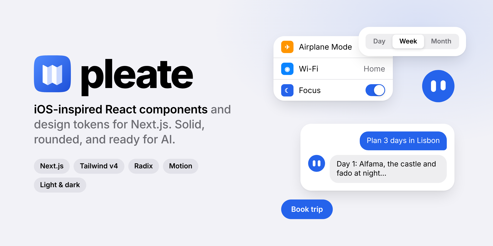
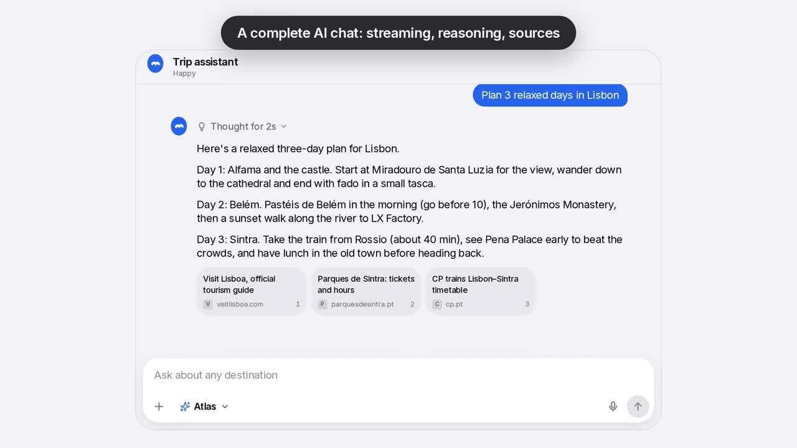

<p align="center">
  <picture>
    <source media="(prefers-color-scheme: dark)" srcset="media/banner-dark.png">
    
  </picture>
</p>

<p align="center">
  <a href="media/pleate-intro.mp4"><b>Watch the one-minute intro</b></a>
  ·
  <a href="#getting-started">Getting started</a>
  ·
  <a href="#components">Components</a>
  ·
  <a href="#theming">Theming</a>
</p>

# pleate

pleate is a React component library for Next.js that feels like a native iOS app. Surfaces are solid and softly
shadowed, corners are generously rounded, spacing is calm, and motion is quick and springy without getting in the way.

It ships more than 90 components, from buttons and form fields to bottom sheets, a full AI chat and marketing
sections. Every one of them follows your palette, works in light and dark mode, adapts to phones and desktops, and
respects people who prefer reduced motion.

[](media/pleate-intro.mp4)

## Why pleate

- **Native feel on the web.** Large titles that collapse as you scroll, bottom sheets you can drag between heights,
  action sheets, swipe actions on list rows, a segmented control with a sliding thumb.
- **Solid, not glass.** No blur and no frosted panels. Opaque surfaces, soft shadows and a clear hierarchy.
- **Your colors.** Pick one of ten palettes, or hand pleate a single brand color and it builds a full palette in
  OKLCH, checking every text and background pair for WCAG AA contrast.
- **Accessible by default.** Built on Radix primitives, with keyboard support, visible focus, sensible ARIA and
  screen reader announcements where they matter.
- **Ready for AI products.** Chat thread, composer with attachments, streaming text, reasoning panels, sources and an
  expressive assistant avatar that can react to your voice.
- **Small where it counts.** Every component is its own module, so you only ship what you import.

## Getting started

pleate targets Next.js with the App Router, React 19 and Tailwind CSS v4.

> pleate isn't on npm yet. Until it is, clone this repository, run `npm install` and `npm run build:lib`, then
> install the package from `packages/pleate` (for example with `npm pack` and the resulting tarball).

**1. Add the styles** after Tailwind in your global stylesheet, and let Tailwind see the classes pleate uses:

```css
/* app/globals.css */
@import "tailwindcss";
@import "pleate/styles.css";
@source "../node_modules/pleate/dist";
```

**2. Set up the theme** in your root layout. `ThemeScript` applies the saved theme before the first paint, so the
page never flashes the wrong colors.

```tsx
// app/layout.tsx
import { ThemeProvider, ThemeScript } from "pleate/theme";

export default function RootLayout({ children }: { children: React.ReactNode }) {
  return (
    <html lang="en" suppressHydrationWarning>
      <head>
        <ThemeScript />
      </head>
      <body>
        <ThemeProvider>{children}</ThemeProvider>
      </body>
    </html>
  );
}
```

**3. Use the components.**

```tsx
import { Button } from "pleate/button";
import { Switch } from "pleate/switch";

export function Settings() {
  return (
    <div className="flex flex-col gap-4">
      <Switch label="Offline maps" labelPlacement="start" defaultChecked />
      <Button size="lg">Save changes</Button>
    </div>
  );
}
```

## Components

Each component lives at its own path, for example `pleate/button` or `pleate/ai/chat`.

| Group | What's inside |
| --- | --- |
| Base | Button, IconButton, Input, Textarea, Select, Checkbox, Radio, Switch, Slider, Badge, Avatar, Tag, Label, Spinner |
| Layout | Container, Stack, Grid, Card, Divider, Section, Navbar, NavigationBar (iOS large title), Sidebar, Footer, TabBar |
| Navigation | Tabs, SegmentedControl, Breadcrumb, Pagination (with range summary), Menu, ContextMenu, Dropdown |
| Overlay | Modal, BottomSheet, ActionSheet, AlertDialog, Popover, Tooltip, Toast, Alert |
| Feedback | Skeleton, Progress, ProgressCircle, EmptyState, NotificationBell, NotificationCenter |
| Data | Table, DataTable, List (iOS Settings style), Accordion, Timeline, StatCard, SessionList, ApiKeyList |
| Forms | Form and FormField with validation, PasswordInput, OTPInput, Calendar, DatePicker, SearchBar, FileUpload (with upload progress) |
| Auth (`pleate/auth/*`) | AuthCard, LoginForm, SignupForm, ForgotPasswordForm, ResetPasswordForm, TwoFactorForm, TwoFactorSetup, OAuthButtons |
| AI (`pleate/ai/*`) | BotFace, ChatThread, Message, Composer, StreamingText, PromptSuggestions, ResultCard, ModelPicker, Reasoning |
| Effects (`pleate/effects/*`) | BlurText, RotatingText, GradientText, CountUp, ScrollRevealText, Reveal, Parallax, PageTransition, Magnet, Spotlight, Tilt, ClickSpark |
| Marketing (`pleate/marketing/*`) | Hero, FeatureGrid, Pricing, Testimonials, CTA, Newsletter, ContactForm, LogoMarquee |

The documentation app shows every component with live examples, the code behind each one, its props and notes on
accessibility. There's also a complete example landing page built only with pleate.

## Backend

pleate also ships the other half. [`pleate-backend`](packages/pleate-backend) is a set of reusable
Django apps on MongoDB (through the official django-mongodb-backend) with a REST API and an OpenAPI
schema, and [`pleate-client`](packages/pleate-client) is a typed client with React hooks that connect
each component to its endpoint:

```tsx
const list = useList<Product>("/catalog/products");
<DataTable columns={columns} getRowId={(p) => p.id} {...list.tableProps} />

const login = useLogin({ onSuccess: () => router.push("/") });
login.mfaRequired ? <TwoFactorForm {...login.twoFactorFormProps} /> : <LoginForm {...login.loginFormProps} />
```

It covers authentication with sessions, password reset and email verification, two factor, OAuth,
roles and feature flags, API keys, lists with pagination, search, ordering and filters, file uploads,
live notifications, emails, an activity log, rate limiting, cache, Celery tasks, signed webhooks,
streaming AI chat, newsletter, contact and waitlist, Stripe billing and a back office API, with
messages in English, Italian and Spanish. The Backend section of the docs explains each part with
live examples, and [`apps/backend-demo`](apps/backend-demo) is a complete project to start from.

## Theming

Colors, radii, shadows and timing are all design tokens, exposed as CSS variables and as Tailwind utilities such as
`bg-surface`, `text-accent-ink` or `rounded-xl`. Nothing in the components is hard-coded, so a palette or theme change
reaches everything at once.

```tsx
"use client";
import { useTheme } from "pleate/theme";

const { setTheme, setPalette, setCustomColor } = useTheme();

setTheme("dark");          // "light", "dark" or "system"
setPalette("teal");        // any of the built-in palettes
setCustomColor("#ff2d55"); // a whole palette from one color
```

You can also pin a palette or a theme to a single part of the page, which is handy for a dark band on a light page:

```html
<section data-theme="dark" data-palette="rose">…</section>
```

To make the whole library rounder or tighter, change one variable: `--pl-roundness: 1.25`.

## Motion and accessibility

Motion uses shared springs and the iOS easing curve, so everything moves in the same way. When someone turns on
"reduce motion" in their system settings, animations stop and every component shows its final state straight away.

Interactive components support the keyboard, show a clear focus ring, and expose the right roles and labels. Long
operations announce themselves politely, and errors in forms are linked to their fields and read aloud.

## Running the docs locally

```bash
git clone https://github.com/Helixo22/pleate.git
cd pleate
npm install
npm run dev
```

Then open http://localhost:3000.

| Path | Contents |
| --- | --- |
| `packages/pleate` | The library. `npm run build -w pleate` builds it, `npm run palettes -w pleate` regenerates the palettes. |
| `packages/pleate-backend` | Django + MongoDB apps. `docker compose up -d` then `uv run pytest` inside it. |
| `packages/pleate-client` | Typed client, React hooks and the in-memory mock backend. `npm test -w pleate-client`. |
| `apps/docs` | The documentation, live examples and the example landing page. |
| `apps/backend-demo` | Example Django project used by the docs and the end to end tests. |
| `media` | Logo, banners and the intro video. |

## License

MIT
